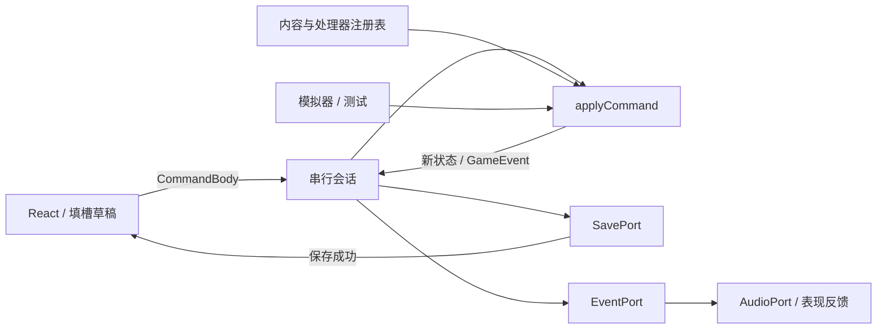

# 架构与扩展指南

## 状态流



`core/` 不引用 React、DOM、Zustand 或数据库。所有状态都是可序列化数据，随机数状态也包含在其中。`createRun`、`previewAction`、`applyCommand`、`enumerateDrafts`、`forecastIntents` 从 `src/core/index.ts` 导出，可以直接用于模拟、测试或新的渲染端。

## 两个宿主，一个内核

`SavePort` 是唯一的宿主分界线：

| 适配器 | 位置 | 宿主 |
| --- | --- | --- |
| `IndexedDbSaveRepository` | `src/platform/storage.ts` | 浏览器 |
| `DesktopSaveRepository` | `src/platform/desktop.ts` | Tauri 桌面 |
| `MemorySaveRepository` | `src/platform/storage.ts` | 测试 / 模拟器 |

`src/application/runtime.ts` 在启动时用 `isDesktop()` 选一个注入 `createSession`。组件、会话、内核都不知道自己跑在哪里。新增宿主（例如云存档）只需再写一个 `SavePort`。桌面实现与构建见 [桌面版构建与运行](desktop.md)。

## 核心接口

```ts
createRun(config: RunConfig, seed: string, catalog: Catalog): GameState
previewAction(state: GameState, draft: ActionDraft, catalog: Catalog): PreviewResult
applyCommand(state: GameState, command: GameCommand, catalog: Catalog): TransitionResult
enumerateDrafts(state, cardId, catalog, options): ActionDraft[]
```

- `CardDefinition` 为规则；`CardInstance` 为有独立身份、可铭刻的实际卡牌。`rarity` 只驱动外观。
- `NumberToken` 有身份、来源和重掷资格；相同数值不等于同一筹码。
- `ActionDraft` 只描述卡牌、各槽筹码身份、目标和选项，尚未消费资源。
- `PreviewResult` 返回合法性、明确原因、槽值、完整算式和标准效果。
- `TransitionResult` 区分 accepted/rejected。拒绝时返回原状态对象，不推进 RNG。
- `expectedRevision` 拦截过期命令；会话还有同步 busy 锁，阻止保存期间的重复确认。

## 意图预测

`src/core/forecast.ts` 只做投影，不复制规则：

```ts
intentAt(catalog, enemy, turn): EnemyIntent | null
forecastIntents(catalog, enemy, fromTurn, count): IntentForecast[]
incomingDamage(enemies): number
```

它调用与 `beginTurn` 完全相同的 `EnemyBehavior.intent`，因此预测不可能与真实结算漂移，并且不触碰随机数状态。界面用它渲染「未来两回合攻击」与标题栏的受创预估。新增敌人行为时无需改动预测层。

## 增加同机制卡牌

在 `src/content/catalog.ts` 中加入定义；加入 `rewardPool` 后可作为奖励。已有处理器支持产数、变量、数值攻防（含 sum / product / square / difference）、微调、翻倍、分解、拆分、复制、抽牌、寄存器和余项。

```ts
const expanded = createCatalog({
  cards: {
    'heavy-strike': {
      id: 'heavy-strike', name: '重击', subtitle: 'HEAVY STRIKE',
      description: '造成数字的 3 倍伤害。',
      kind: 'attack', cost: 2, rarity: 'uncommon', symbol: '3n',
      slots: [{ label: 'n', rule: 'any' }], engravable: true,
      effect: { type: 'numerical', params: { multiplier: 3 } },
    },
  },
  rewardPool: [...catalog.rewardPool, 'heavy-strike'],
});
```

`createCatalog` 合并记录和规则覆盖，数组（地图、奖励池）整体替换。`createCatalog({ rules: { energy: 4 } })` 也可用于实验配置。内容版本改变时，必须评估旧存档是否仍兼容。

UI 不需要为新卡牌写任何分支：卡面颜色来自 `kind`，外发光来自 `rarity`，槽位与算式来自 `CardDefinition`。

## 增加新机制

在 `Catalog.effects` 注册 `EffectHandler.resolve(context)`。处理器不修改状态、不消耗随机数，只返回算式、拒绝原因和 `ResolvedEffect[]`；预览与实际执行共享此结果。

能用现有 `damage / block / generate / draw / store / power` 组合表达的效果，无需增加卡牌 ID 分支。新增底层效果时，扩展 `ResolvedEffect` 与内核执行分支，再增加相应测试。若机制需要新参数输入，在 `Battle.tsx` 的出牌面板增加控件，保持草稿只存在于 UI。

当前数值管线：槽值与条件检查 → 槽内运算 → 卡牌倍率 → 敌人倍率 → 向下取整 → 单次效果上限。奇偶守卫根据槽内运算结果判断；埃氏筛检查全部有效槽值，包含铭刻槽。铭刻不产生可消费筹码。

## 增加敌人、角色、遗物和地图

- **敌人**：已有行为可直接增加 `EnemyDefinition`。新行为实现 `EnemyBehavior.intent`，需要时实现 `damageMultiplier`。当前回合的意图存入状态，受伤后的阶段变化从下一回合生效。需要新外观时扩展 `EnemyArt`，`theme` 字段只作配色提示。
- **角色**：增加 `CharacterDefinition`，提供最大生命、起始牌组和遗物，再从 `createRun({ characterId })` 选择。当前菜单只显示代数师；多角色入口需补 UI。
- **遗物**：初版的 `RelicDefinition.turnStartNumbers` 是真实生效的起始产数接口。其他生命周期效果需扩展定义与内核触发点，不能仅添加一段说明文字。
- **地图**：`Catalog.map` 为独立节点序列，可改层数、敌人组合和休息位置。`MapNode.kind` 目前有 battle/rest/boss，节点图标按 kind 着色。分叉路线、商店、事件等新节点需要扩展类型、命令与会话流程，当前不提供假入口。
- **多敌人**：`node.enemies` 写多个 ID 即可，内核、目标选择、存档校验与预测都已支持；界面为每个敌人渲染独立意图气泡、血条与站台。第 2 层的双小史莱姆是现状参考。

## 休息点选项

`CommandBody` 中的 `rest-heal`、`engrave-card`、`rest-remove` 都要求 `screen === 'rest'`，成功后调用同一个 `nextNode` 推进层数。净化额外校验 `rules.removeCost` 与 `rules.minDeck`。新增休息选项时：加命令 → 内核分支 → `RestScreen` 的 `mode` 增加一个取值。

## 平台适配

`src/platform/contracts.ts` 提供：

| 接口 | 用途 | 当前实现 |
| --- | --- | --- |
| SavePort | load / save / import / export / loadProfile | IndexedDbSaveRepository、DesktopSaveRepository、MemorySaveRepository |
| AudioPort | unlock / play / setEnabled | WebAudioAdapter |
| EventPort | publish / subscribe | GameEventBus |

通过 `createSession(catalog, saves, bus)` 注入。云存档只需再提供一个适配器；规则内核不感知网络、音频或 DOM。

## 存档和版本

存档外层包含 `format`、`schemaVersion`、`savedAt` 和完整 `GameState`。后者包括规则版本、内容版本、四条独立随机流（map/battle/reward/event）的状态，以及对局、牌堆、筹码和强制选择。

`save-schema.ts` 用 Zod 校验结构，并检查卡牌守恒、身份、铭刻条件、资源边界和待弃数状态。当前 schema v1 / rules v1 / content 0.3.0。

升级格式时在 `saveMigrations` 注册逐版本迁移，更新目标版本并补旧快照测试；未知版本拒绝导入，不修改传入文件。内容或规则版本不匹配时也拒绝，避免悄悄按新规则解释旧局。

浏览器实现用 IndexedDB 事务同时写对局和本机图鉴历史。`current` 保留当前有效对局，`backup` 保留前一个有效对局；不可读取的旧内容在再次保存时转存为 `unreadable`，不覆盖有效备份。桌面实现用同名 JSON 文档，写入通过临时文件 + 原子替换完成。

会话先得到内核结果，再持久化，成功后才向界面和事件总线发布。失败时保留 `pending`，禁用后续命令；重试成功后只发布一次，导出优先使用待存状态。

## 验证扩展

1. 单卡测试验证预览和结算一致、非法输入不扣资源。
2. 新随机机制只操作指定的随机流，补保存恢复和命令复现测试；预览显示分布，不能调用 RNG。
3. 新牌堆或资源区增加守恒校验与性质测试。
4. 更新模拟器的策略估值，比较固定种子，不用模拟胜率替代试玩。
5. 通过实际界面验证点击、拖放、确认、取消、读档与目标选择。

纯模拟入口是 `tools/simulate.ts`，三种基线策略在 `tools/policies.ts`。这两者使用生产内核，没有独立复制战斗规则。
