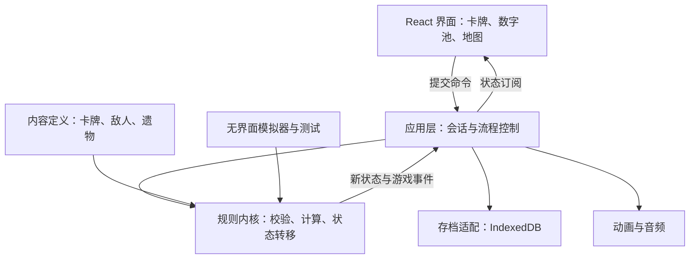

# 《数字尖塔》游戏设计与技术方案 v0.2

采用 **TypeScript + React + Vite**，以独立的战斗规则内核驱动游戏。

已确定的方向是：**电脑浏览器优先、策略玩法为主、保留产数牌驱动、极简扁平风、分阶段扩展到完整游戏**。以下锁定整体架构和首个可玩版本的实现规格，后续内容按同一架构扩展。

## 一、游戏定位与核心玩法

玩家通过产出数字、加工数字、填入卡牌槽位来战斗，再通过选牌、铭刻和遗物形成构筑。核心乐趣是：**同一组数字，如何根据敌人意图分配出最合适的攻防组合。**

完整游戏保留三幕结构；第一幕目标时长 20～30 分钟，完整三幕目标 60～90 分钟。知识解释放在可选图鉴中，战斗界面直接呈现实际效果。

### 基础规则

| 项目 | 确定方案 |
|---|---|
| 初始生命 | 60 |
| 每回合能量 | 3 |
| 每回合抽牌 | 5 张，手牌上限 10 |
| 数字池 | 容量 6；超出后进入弃数选择，完成选择才能继续行动 |
| 数域 | 首版使用 0～99 的非负整数 |
| 数字消耗 | 每枚筹码有独立身份；成功出牌后消耗对应筹码 |
| 护甲 | 挡伤后扣减，玩家下一回合开始清零 |
| 伤害与护甲 | 单次效果上限 99；负结果按 0 处理 |
| 暂存 | 填槽、换槽、取消免费，确认后才结算 |
| 战斗结束 | 敌人全部死亡后立即胜利，跳过后续敌方行动 |

产生超过筹码范围的加工操作不可确认，并显示原因；不静默截断数字。拆分必须满足 `a + b = n` 且 `a、b ≥ 0`，除数为零和槽位条件不满足时不能出牌。

回合顺序固定为：

`清除玩家护甲 → 恢复能量 → 起始遗物与保留数字生效 → 抽牌 → 公布敌人意图 → 玩家行动 → 回合末效果 → 弃牌与清理数字 → 敌人行动`

敌人本回合已公布的行动保持不变；阶段切换对下一回合生效。

### 代数师作为首个角色

- 起始遗物保留「常数表」：每回合获得一个 2。
- 起始牌组：常数×4、变量 x×1、打击×1、防御×2、累加×1、双联×1。
- 常数：0 费，获得一个 3。
- 变量 x：1 费，选择 1～4，生成两枚该数值的独立筹码。

这样保留了产数牌驱动，同时让乘法组合从开局就参与决策。在已枚举的 252 种起手中，这套牌的最优纯伤害均值约为 **8.85**、最大值为 **16**；这些只作为原型参数依据。

### 成长与构筑

第一版支持三种主要方向：

- **乘积爆发**：加工数字，再用双联或平方集中输出。
- **条件攻防**：围绕质数、偶数等条件提高数字利用率。
- **资源经营**：利用拆分、寄存器、抽牌与余项调整资源节奏。

战斗奖励提供三张不同卡牌供选择，也可以跳过。休息点选择回复最大生命的 30%，或铭刻一张攻防卡。铭刻值限定为 1、2、3，必须符合槽位条件，每张卡只能铭刻一个槽。

局外进度记录图鉴、成就和内容解锁；角色基础属性保持一致。

## 二、首版内容、敌人与交互

### 首个可玩版本使用 16 种卡牌

| 类别 | 卡牌与效果 |
|---|---|
| 产数 | 常数：0 费获得 3；变量 x：1 费生成两枚相同的 1～4 |
| 基础攻防 | 打击：1 费造成 n 伤害；防御：1 费获得 n 护甲；累加：1 费将两个数相加，选择攻击或防御；双联：2 费造成乘积伤害 |
| 条件与爆发 | 质数之刃：1 费，质数×2 伤害；偶数壁垒：1 费，偶数×1.5 护甲；平方：2 费，平方伤害，消耗 |
| 数字加工 | 微调：0 费，将一枚筹码 ±1；因式分解：1 费，将合数拆成两个均大于 1 的因数；翻倍：1 费，将筹码×2；拆分：1 费，将筹码拆成两个非负整数 |
| 资源调度 | 平衡：1 费，两个槽之和等于 10 时抽 2 张；寄存器：0 费，将一枚筹码移入暂存区，下回合返还，每回合限一次 |
| 能力 | 余项：1 费，每回合末对所有敌人造成等于池中未用筹码数量的伤害 |

正在结算的卡牌不参与洗牌；普通牌结算后进入弃牌堆，消耗牌进入消耗区，能力牌进入能力区。牌库耗尽时洗入弃牌堆，超过手牌上限的抽牌进入弃牌堆。

### 短流程采用六层

`加法史莱姆 → 倍增虫 → 休息 → 奇偶守卫 → 休息 → 埃氏筛`

三场普通战斗结束后均获得一次选牌奖励。这一流程用于验证战斗、成长、铭刻、存档和通关闭环。

| 敌人 | 初始参数 | 机制 |
|---|---|---|
| 加法史莱姆 | 24 HP | 攻击依次为 4、6、8…… |
| 倍增虫 | 18 HP | 攻击为 2、4、8、16，之后保持 16 |
| 奇偶守卫 | 28 HP，攻击 6 | 攻击牌槽内计算结果的奇偶与回合奇偶不符时，伤害倍率为 0.5 |
| 埃氏筛 | 短流程 72 HP | 每回合轮换标记 2、3、5；攻击牌任一有效槽值是标记数的倍数时，增加一次 0.5 伤害倍率；防御与加工正常使用 |

埃氏筛按剩余生命的三等分进入阶段，攻击分别为 4、6、8。界面同时显示当前和下一回合的筛选因子。上述数值均为首轮实验参数。

### 界面与操作

- 上方：生命、能量、遗物、层数。
- 中央：敌人、血量、当前意图、下一步规律。
- 下方：数字池与手牌。
- 选牌后展开槽位、目标选择和完整算式，最终伤害或护甲始终可见。
- 同时支持拖放和点击填槽；唯一合法填法可一键填入。
- `Enter` 确认、`Esc` 取消；结束回合有独立按钮。
- 支持查看抽牌堆、弃牌堆、消耗区和战斗记录。

美术采用 SVG 几何角色、清晰色块与轻量动效。攻击、护甲、产数和加工同时使用颜色及图标区分。主要适配 1280×720 和 1920×1080，提供减少动画选项。

## 三、技术框架选择

本项目以卡牌、槽位、文字和少量角色动画为主，采用 DOM/SVG 能直接处理布局、文本清晰度和交互。规则内核独立后，后续增加更复杂的渲染层也能继续复用战斗逻辑。

| 层面 | 选择 | 用途 |
|---|---|---|
| 开发环境 | Node.js 24、pnpm 11、TypeScript 严格模式 | 统一工程和类型约束；当前环境已确认可用 |
| 构建与界面 | React + Vite | 单页游戏、组件化界面、开发与静态构建。[官方说明](https://react.dev/learn/build-a-react-app-from-scratch) |
| 画面与样式 | DOM、SVG、CSS Modules | 卡牌、筹码、敌人、地图和主题样式 |
| 动画 | Motion for React | 手牌展开、筹码移动、受击、数字跳动。[官方文档](https://motion.dev/docs/react) |
| 状态订阅 | Zustand | 将游戏会话状态提供给界面，按需更新组件。[官方文档](https://github.com/pmndrs/zustand) |
| 数据校验 | Zod | 校验内容定义、导入存档和版本迁移结果。[官方文档](https://zod.dev/) |
| 本地存档 | IndexedDB + Dexie | 当前对局、历史记录、设置与图鉴。[官方文档](https://dexie.org/docs/Tutorial/Design) |
| 随机数 | pure-rand，固定 xoroshiro128plus 算法 | 种子随机、均匀骰子分布与复现。[官方文档](https://github.com/dubzzz/pure-rand) |
| 验证 | Vitest、fast-check、Playwright | 规则测试、随机性质测试、浏览器流程测试。[Vitest](https://vitest.dev/guide/)、[fast-check](https://fast-check.dev/docs/introduction/)、[Playwright](https://playwright.dev/docs/intro) |
| 音频 | Web Audio 与本地音频资源 | 简单反馈音效和背景音乐 |

工程采用单仓库、单前端应用，各依赖锁定版本并提交锁文件。

游戏运行与存档都在客户端完成。交付物为 Vite 构建的静态资源包，可以部署到 HTTPS 静态服务器；发布地址和账号接入属于部署阶段事项。[Vite 静态部署说明](https://vite.dev/guide/static-deploy.html)

## 四、软件架构与核心接口

采用**模块化单体、单向状态流、显式状态机、数据驱动内容**。



### 模块职责

| 模块 | 负责内容 |
|---|---|
| 规则内核 | 数学运算、槽位限制、出牌、抽牌、敌人行动、伤害、状态效果 |
| 内容定义 | 卡牌参数、效果类型、敌人行动模式、奖励池、文本与资源引用 |
| 应用流程 | 开始游戏、战斗与奖励切换、命令排队、自动保存 |
| 界面表现 | 操作、布局、预览展示、动画、音效 |
| 平台适配 | 浏览器存储、存档导入导出、音频、资源加载 |
| 模拟工具 | 使用同一规则内核执行批量战斗并输出统计 |

规则内核使用纯 TypeScript，独立于 React、DOM 和数据库。组件提交命令，资源扣除和战斗结果统一由内核产生。

### 核心数据

- `CardDefinition`：卡牌的固定规则、费用、槽位、效果类型。
- `CardInstance`：某张实际卡牌的身份、所属区域和铭刻。
- `NumberToken`：筹码身份、数值、来源，以及是否仍可重掷。
- `RunState`：角色、生命、金币、牌组、遗物、地图和进度。
- `BattleState`：手牌与各牌堆、数字池、敌人、回合、待处理选择。
- `GameEvent`：已发生的出牌、产数、伤害、护甲和战斗结束事件。

内容使用带类型约束的纯数据对象，效果由固定处理器注册表执行。新增同机制卡牌主要增加数据；新增机制增加处理器及对应测试。

### 对外接口

```ts
createRun(config, seed, catalog): GameState

previewAction(
  state,
  draft,
  catalog
): PreviewResult

applyCommand(
  state,
  command,
  catalog
): TransitionResult
```

`TransitionResult` 返回新状态、游戏事件或明确的拒绝原因。非法命令不扣资源、不改变随机数状态。

`PreviewResult` 返回合法性、限制原因、算式步骤和预期效果。随机效果显示分布或范围，不暴露下一次实际骰点，也不推进随机数。

### 必须统一的规则

1. 预览与实际结算共用数学计算与合法性检查。
2. 结算顺序固定为：槽值修正 → 条件校验 → 槽内运算 → 乘法修饰 → 加法修饰 → 向下取整 → 上限。
3. 除法卡在运算自身的步骤执行向下取整；伤害倍率等修饰在最终步骤统一取整。
4. 动画只消费游戏事件；跳过动画不改变战斗结果。
5. 暂存填槽属于界面状态，确认后才成为游戏命令。
6. 产数超容量属于明确的待选择状态，保存后重新打开仍可继续弃数。
7. 命令串行处理，重复确认不能重复扣费或产数。

### 随机、存档与复现

- 每局持有种子；地图、战斗、奖励和事件使用独立随机序列。
- 存档保存完整游戏状态、随机序列状态、内容版本和规则版本。
- 每个有效命令后自动保存，随机结果在对应存档成功后展示。
- 保存失败显示真实状态，提供重试及导出；不显示假成功。
- 保留最近一个有效备份，支持 JSON 导入导出。
- 可迁移版本执行显式迁移；不兼容存档保留原文件并说明原因。
- 同一版本、种子和命令序列必须复现相同结果。

战斗状态区分回合开始、玩家行动、待选择、敌方行动、胜利和失败。动画是否播放由表现层单独控制。

## 五、实施阶段与验收标准

| 阶段 | 交付内容 | 完成标准 |
|---|---|---|
| M0：规则基础 | 工程初始化、内容定义、战斗内核、种子随机、模拟命令 | 能在无浏览器环境下完整执行战斗，规则与预览测试通过 |
| M1：首个可玩版本 | 代数师、16 种卡牌、六层短流程、三选一奖励、铭刻、战斗界面、存档 | 能从主菜单开始、完成或失败、继续存档并重新开局 |
| M2：第一幕版本 | 加入概率师、15 层分叉地图、商店、事件、更多遗物与卡牌 | 两个角色均具备完整一幕流程，构筑方向经过试玩验证 |
| M3：完整游戏 | 函数山谷、矩阵空间、数论师、几何师、难度进阶及完整图鉴 | 三幕衔接成立，所有角色均有处理各幕机制的公共工具 |

M2 延续现有草案的内容方向，但采用以下约束：

- 概率师保留骰子牌产数；重掷牌每次打出只重掷一次，之后正常弃置，骰盅每回合额外提供一次免费重掷。
- d4 掷出 4 时最多追加一次，保留两个结果。
- 加工后的骰子筹码失去重掷资格，避免来源与加工效果混淆。
- 第一幕仍使用非负整数，分数骑士替换为围绕余数提供攻防奖励的精英。
- 地图保留第 1 层战斗、第 8 层宝箱、第 14 层休息、第 15 层 BOSS，精英从第 6 层起出现。
- 事件优先采用赌场、二分猜数和资源交换；赌场采用同净期望、不同波动的两种选项。
- 后续向量机制提供公共卡入口；几何师获得效率优势，各角色都能完成主线战斗。

### 规则验收

- 相同数值的不同筹码能分别使用；同一枚筹码不能被重复消费。
- 取消填槽不改变任何游戏资源。
- 零、质数、偶数、平方数、除零、上限、超容量和铭刻边界全部有测试。
- 牌库洗牌后卡牌总数守恒；结算中的卡牌不被提前抽回。
- 击杀后不再承受该敌人的行动。
- 确定性效果的预览与实际结果完全一致。
- 任意合法命令序列不产生负能量、重复卡牌身份或非法牌堆归属。
- 存档恢复与连续运行产生相同的后续骰点、抽牌和奖励。

### 浏览器验收

- 点击和拖放能够完成同一套出牌流程。
- 连续点击确认、拖放取消、窗口缩放和动画跳过不会造成重复结算。
- 在 1280×720 与 1920×1080 下，手牌、槽位、数字池和敌人意图完整可读。
- 桌面 Chrome、Edge、Firefox 完成开始游戏、战斗、奖励、铭刻、读档和通关流程。

### 平衡验证

模拟器使用攻击优先、防御优先和混合策略，按固定种子批量运行，输出通关情况、战斗回合、损血、资源空转及卡牌使用率。模拟结果用于比较改动，人工试玩用于确认决策是否有趣。

首轮调参目标为普通战斗约 2～4 回合、BOSS 约 6～10 回合。M1 验收后再扩大卡池，避免在规则尚未稳定时同时调整大量内容。

实施时先将现有[游戏设计文档](D:/wkspace/ClaudeWkspace/MathGame/docs/game-design.md)修订为 v0.2，记录上述规则、参数与验收口径，再进入 M0 和 M1。
